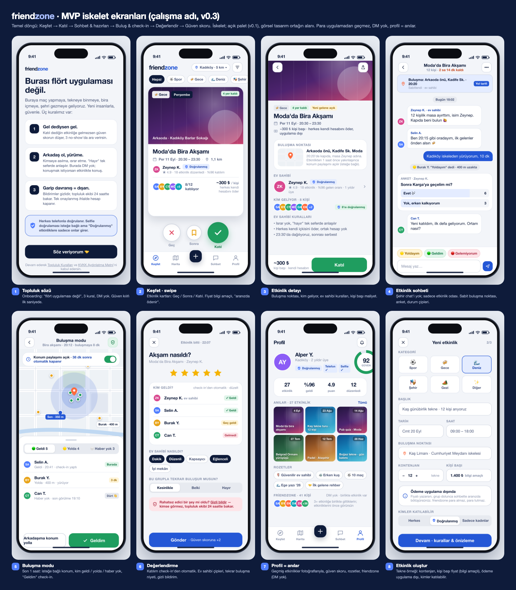
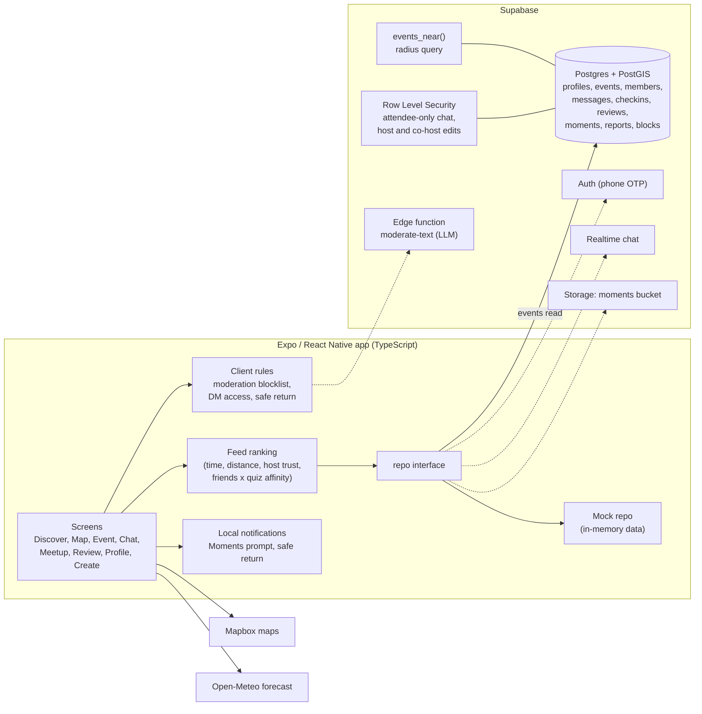
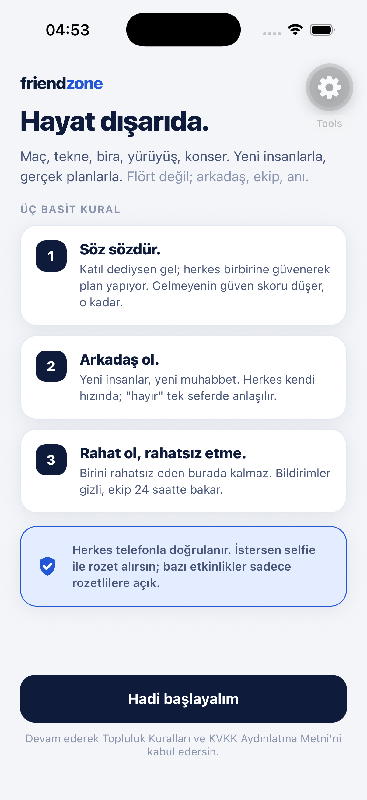
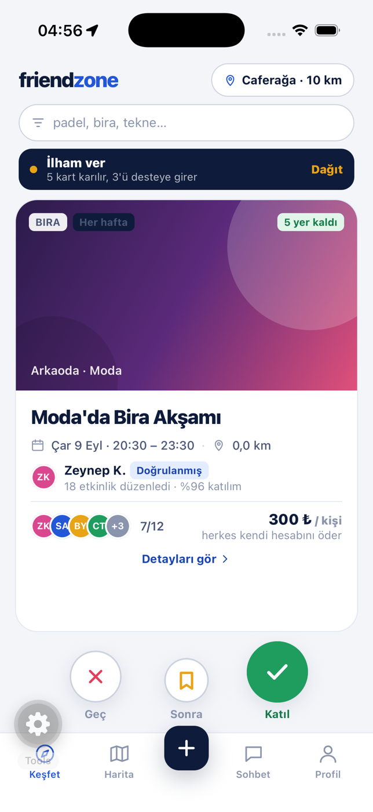
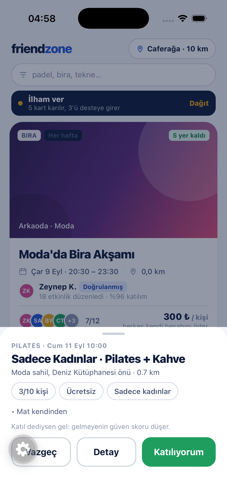
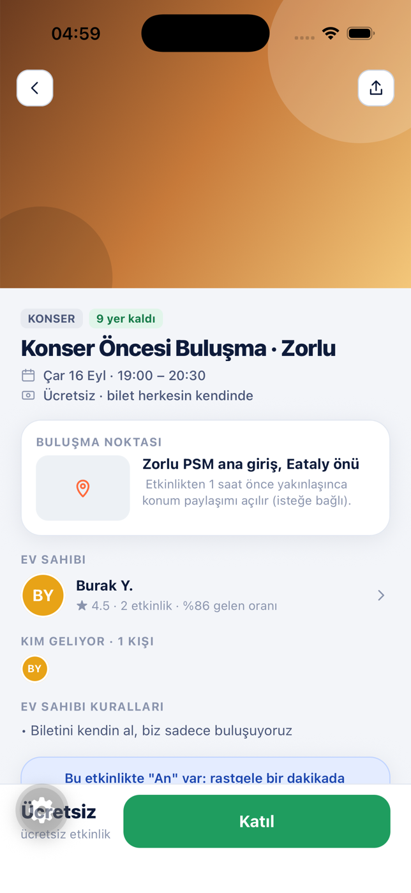
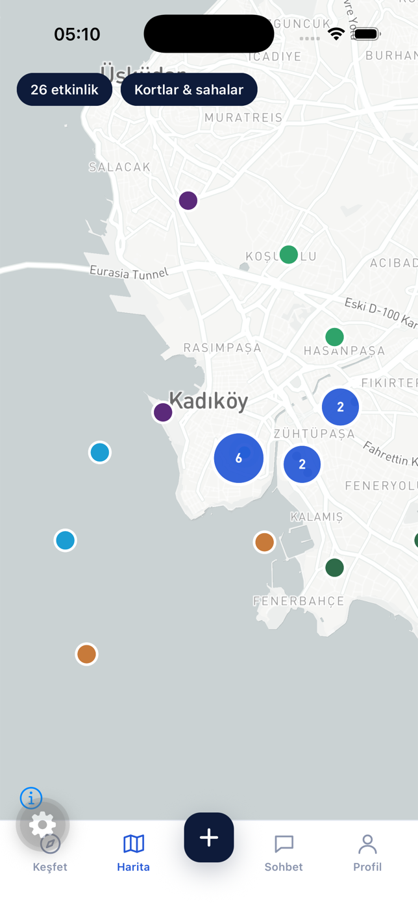
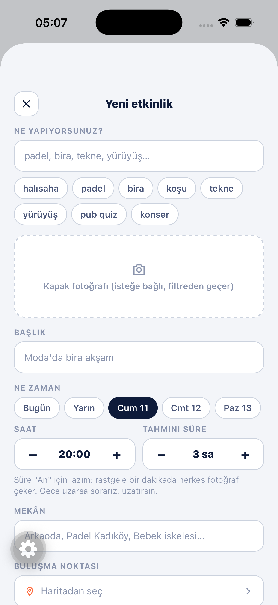
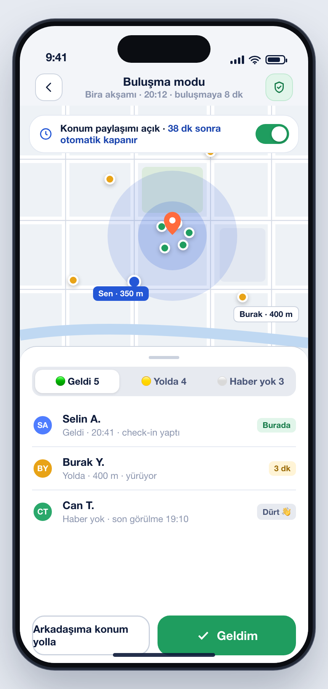
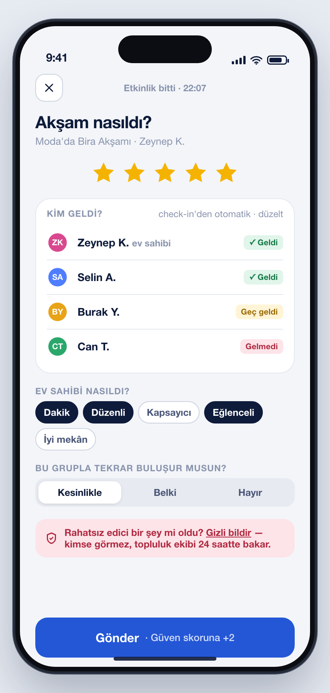

# friendzone

**An event-first friend-making app for Turkey: swipe through real plans nearby, join, meet up, and build trust through showing up.**

  

## Why

Turkey reports some of the highest loneliness in the world: 54% of Turkish respondents told [Ipsos](https://www.ipsos.com/en/loneliness-increase-worldwide-increase-local-community-support) they feel lonelier than in previous years. At the same time, people are tired of swiping on faces: 78% of US dating app users report burnout ([Forbes Health / OnePoll](https://www.forbes.com/health/dating/dating-app-fatigue/)), and the big players are pivoting toward group meetups. Safety is the third driver: in local survey data 68% of women aged 18 to 29 say they do not feel safe out at night. Local alternatives are single-vertical tools (five-a-side football rosters, padel court booking, run club directories) or invite-only WhatsApp groups, so nobody answers "what should I do on Saturday, and with whom?"

friendzone is not a dating app. Cards are events, not people. There is no "like", no public profile browsing, and money never moves through the app.

## What it does

- **Community pledge onboarding.** Three house rules ("show up if you said you would", "be a friend", "don't make anyone uncomfortable") plus a 10-card quiz that produces a persona and feed preferences.
- **Swipe discovery of events.** Skip / Later / Join on a card deck, radius sheet, search by tags like "padel" or "pub quiz", and an "Inspire me" button that shuffles 5 themed cards and deals 3 into the deck.
- **Event pages built for strangers.** Meeting point on a map, who is coming, host rules, informational per-person cost ("split among yourselves"), audience limits (everyone, verified only, women only), and weather warnings for outdoor plans.
- **Event chat rooms and groups.** One room per event with a pinned meeting point, polls, system messages and On my way / Arrived / Can't make it status chips. Topic or district groups live in a side drawer.
- **Meetup mode.** Opens 60 minutes before start: opt-in timed location sharing that switches itself off, who has arrived or is on the way, and an "Arrived" check-in gated by a 150 m geofence.
- **Ratings of events, not people.** Stars, host tags, "would you meet this group again", and a private report box. If most of the group says yes, the host can repeat the plan with the same people in one tap.
- **Moments.** A BeReal-style prompt at a random minute during the event; everyone shoots within 2 minutes and photos become shared memories on the profile.
- **Safety by design.** Friend requests only to people you actually met at an event, direct messages only between friends, and in a conversation with a woman she sends the first message. Opt-in "Safe return" check after night plans pings a chosen friend.
- **Create an event** in one form: category from tags, cover photo, time and duration, venue, meeting point picked on a map, capacity, informational price, audience, rules, recurrence.

## How it works

The app talks to a single data interface (`repo`). With no backend configured it runs on an in-memory implementation seeded with realistic Istanbul (Kadıköy) data, so every flow is testable on a simulator or a phone. A Supabase implementation fills the same interface. Dashed parts are designed and referenced in code but not wired yet.

## Engineering highlights

- **One data boundary, two implementations.** Every screen goes through a typed `Repo` interface. Mock mode made the whole product testable on device before a backend existed; the Supabase repo extends it and replaces methods one at a time.
- **Schema and RLS written to the product rules.** PostGIS `geography` column generated from lat/lng with a GiST index and an `events_near` radius function. Policies make chat, check-ins, reviews and moments visible only to attendees; only the host or delegated co-hosts can edit an event. Prices are informational columns only, and there is deliberately no DM table yet.
- **Explainable feed ranking.** A pure scoring function combines start time, distance, host trust score, friends attending, an urgency boost and fill rate (social proof, but full events sink), multiplied by quiz affinity. Every 5th slot is an "explore" card from outside the user's top categories so the feed does not become a bubble.
- **Turkish-aware moderation.** Text is normalized for Turkish letters and leetspeak before matching a TR + EN blocklist; event titles also block dating phrasing. A second LLM layer is called through a Supabase edge function for ambiguous slang, and fails open into the report queue rather than blocking users.
- **Safety rules as pure functions.** The DM rule (friends only, women send the first message) lives in one function so the client, a future RLS policy and moderation can enforce the same logic.
- **Native modules behind guards.** Mapbox, video and view capture are loaded defensively, so older dev builds fall back to a list view or text sharing instead of crashing.
- **Weather judged over the event's own hours**, with a stricter wind limit for sea plans, via the free Open-Meteo API with a 30 minute cache.

## Design process

1. **Research and spec.** A market and competitor study (Timeleft, Bumble BFF, Meetup, Playtomic and Turkish single-vertical apps) led to a scope document with positioning, MoSCoW feature list, trust and moderation plan, legal notes (KVKK, app store policies) and a sprint plan.
2. **HTML mockups.** Eight skeleton screens covering the core loop (discover, join, chat, meet, rate, memories), shown in the overview above.
3. **Working skeleton, then a design brief.** The app was built from the mockups, then real simulator screenshots, tokens and constraints were packaged into a design brief for a high-fidelity redesign.
4. **Redesign applied in code.** The returned design system (Outfit typeface, new palette, icon set, motion notes) was implemented as tokens and UI primitives; screens never hardcode colors or font weights.

## Tech stack

| Layer | Tools |
| --- | --- |
| App | Expo SDK 57, React Native 0.86, React 19, TypeScript |
| Navigation and UI | React Navigation (tabs, stack, drawer), Reanimated, Gesture Handler, react-native-svg |
| Maps and location | Mapbox (`@rnmapbox/maps`), expo-location |
| Media and notifications | expo-camera, expo-image-picker, expo-video, expo-notifications |
| Backend | Supabase (Postgres, PostGIS, Row Level Security, edge functions), supabase-js |
| External data | Open-Meteo weather |
| Design | HTML mockups, design tokens, Outfit typeface |

## Screenshots

Simulator captures from the working build (mock data), plus two screens from the HTML mockups.

<table>
  <tr>
    <td align="center"> Community pledge</td>
    <td align="center"> Discover (swipe deck)</td>
    <td align="center"> Join confirmation</td>
    <td align="center"> Event detail</td>
  </tr>
  <tr>
    <td align="center"> Map with clustering</td>
    <td align="center"> Create event</td>
    <td align="center"> Meetup mode (mockup)</td>
    <td align="center"> Rating (mockup)</td>
  </tr>
</table>

## Status and role

Co-founded with a partner who leads visual design and brand. My part: research, product spec, mockups, design brief, and the full React Native app and Supabase schema.

Status: working prototype. All screens and flows run on iOS (simulator and device dev builds) against mock data. The Supabase schema, PostGIS queries and RLS policies are written; reading events from Supabase is wired, while auth, realtime chat, storage and the moderation edge function are the next step. Planned next: TestFlight and a closed beta in one Istanbul neighborhood.

The source code is private. Happy to walk through it or share access on request.
